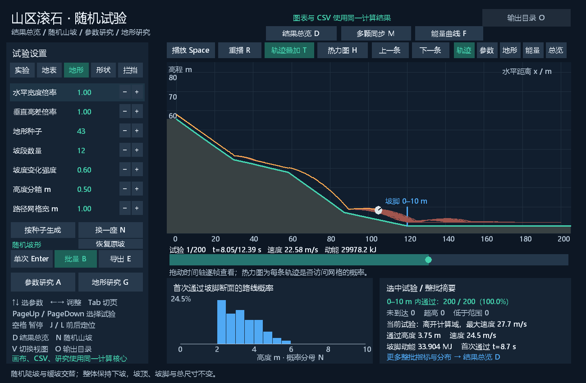
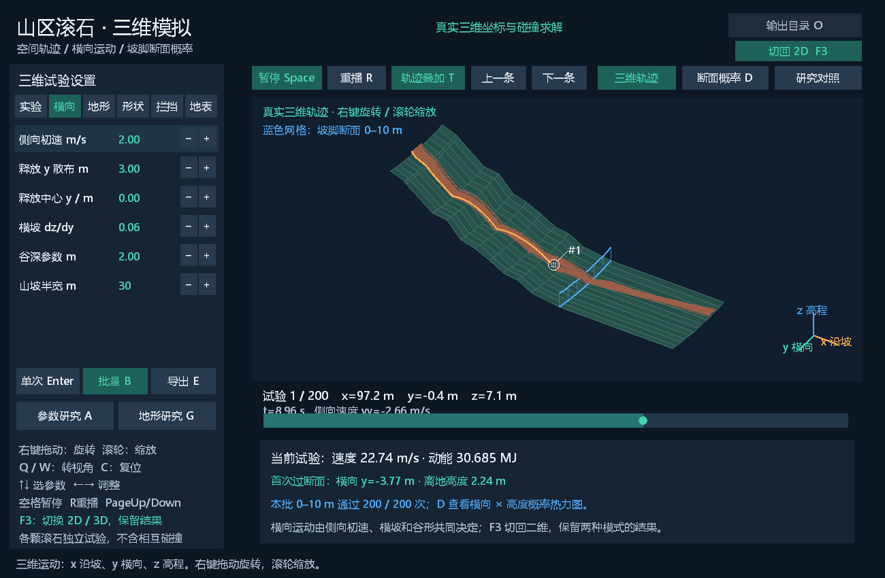
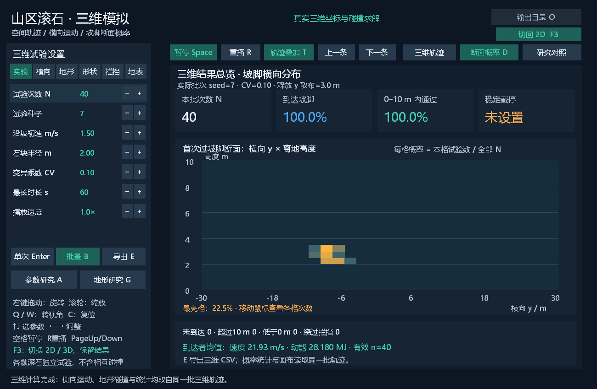

# 山区滚石模拟 · 历史版本归档

全部应用代码使用 C++。**2D、独立 3D、2D/3D 切换版分别存放**；每个版本的源码保持归档时的原样。

## 先选一个版本

| 类型 | 入口 | 说明 |
| --- | --- | --- |
| **2D 版** | [二维最终版源码](2d/07-random-terrain-v2/rollingstone_fixed.cpp) · [2D 版本列表](2d/README.md) | 包含随机模拟、概率、CSV、参数/地形研究、凸多边形、刚性/弹性拦挡；随机地形保持坡形，并有明显坡折。 |
| **独立 3D 版** | [三维球体统计版源码](3d-standalone/02-full/rollingstone3d_full.cpp) · [独立 3D 版本列表](3d-standalone/README.md) | 单独的三维程序，可横向滚动；归档了原型与统计版。这一系列的三维接触形状只有球体。 |
| **2D/3D 切换版（推荐）** | [F3 整合版目录](2d3d-switchable/02-f3-integrated/) · [整合版列表](2d3d-switchable/README.md) | 按 **F3** 切换；3D 支持横向运动、球/凸棱柱、有限宽挡板、概率热力图及研究导出。含 Visual Studio 工程。 |

> 另一份 `rollingstone_fixed_copy.cpp` 也有 3D，按 **3** 进入、Esc 返回，另外有地形 CSV 导入。它保存在[替代整合副本](2d3d-switchable/01-alternative-copy/)，与 F3 版分别保留，未擅自合并功能。

## 在 Visual Studio 中运行

1. 点击仓库的 **Code → Download ZIP**，解压整个文件夹。
2. 打开 `2d3d-switchable/02-f3-integrated/rollingstone_2d3d.vcxproj`。
3. 安装 Visual Studio 的“使用 C++ 的桌面开发”组件以及对应的 **EasyX**，选择 **Release / x64**，按 **Ctrl+F5**。
4. 工程使用本机验证过的 **v145 / C++20 / UTF-8**。其他 Visual Studio 版本需在项目属性中选择已安装的平台工具集，并配置 EasyX 的头文件、库目录。

单独使用其他 `.cpp` 时，新建 C++ 控制台项目，只加入所选版本的一个主 `.cpp`，关闭预编译头、使用 C++17 或 C++20 及 UTF-8，并配置 EasyX。早期原始版本按该版本原工程说明构建。不要把几个历史版本同时加入同一项目，它们都有程序入口。

F3 整合版操作详见[使用说明](2d3d-switchable/02-f3-integrated/使用说明.txt)。源码归档不包含 `.exe`、编译缓存或全部实验输出。

## 以前的版本在哪里

- [12 个原 Git 标签的完整源码快照](archive/2d/git-tags/)，保留各阶段的源码、工程和说明。
- [历史索引与完整 Git 备份](history/README.md)：含 **13 次原提交、4 个分支、12 个标签**，可从 `rollingstone-history.bundle` 恢复原提交 ID 和标签。
- [13 个单文件快照的校验清单](snapshot-manifest.json)：包括 2D 的 9 份源码（其中 2 份仅头部注释不同）、独立 3D 的 2 份、可切换版的 2 份。

原来的 12 个标签保留为 GitHub Tags；原 4 个分支分别保存在 `history/main`、`history/dev`、`history/tasks-1-3`、`history/all-tasks`，原提交 ID 不变。也提供标签源码目录和可离线恢复的 bundle。本仓库 `main` 延续 GitHub 原有初始提交。后续未提交的源码以现存快照保留；文件修改时间不等同于发布时间，也没有补造过去的提交日期。

本次归档未改写 E 盘原文件。字节完全相同的副本去重；仅注释不同的文件放在 `variants` 中。此前明确未选用的另一套多文件项目不混入此单文件版本线。

## 画面示例

二维随机坡形：

F3 整合版的三维运动：

三维坡脚“横向位置 × 高度”概率：

## 模型与归属

这是教学模拟。弹性拦挡采用等效弹簧—阻尼模型，未作真实工程标定。F3 整合版已完成本机编译、数值与界面验证；历史源码原样归档，不表示每一版均重新测试。仓库未新增整体授权许可证；历史第三方文件保留原作者声明。
